# Examples

Each example is a complete scenario: topology, code, timing model, inputs and faults. Load one from the *Example* menu; the run starts playing right away. Loading an example replaces the current scenario, and the notification offers **Undo**.

Each section opens with a schematic of the protocol: the roles, the phases, the messages between them, and the sentence that says why the algorithm works. It is the shape of the algorithm, not a recording of one run — the run is what you get when you press **Run**. For every example this page gives the setup, what to watch, a few experiments, and the simplifications that matter for it. The numbers quoted come from the default seed; a different seed gives a different but equally reproducible run.

## Contents

- [Flooding broadcast](#flooding-broadcast)
- [Ring leader election, Chang-Roberts](#ring-leader-election-chang-roberts)
- [FloodSet consensus](#floodset-consensus)
- [Failure detector ◇P](#failure-detector-p)
- [Failure detector across a partition and a recovery](#failure-detector-across-a-partition-and-a-recovery)
- [Reliable broadcast when the sender crashes](#reliable-broadcast-when-the-sender-crashes)
- [Causal order broadcast: questions before answers](#causal-order-broadcast-questions-before-answers)
- [Gossip: spreading a rumor](#gossip-spreading-a-rumor)
- [Perfect failure detector](#perfect-failure-detector)
- [Eventual leader election Ω](#eventual-leader-election-ω)
- [Mutual exclusion, Ricart-Agrawala](#mutual-exclusion-ricart-agrawala)
- [Two-phase commit and the blocked participants](#two-phase-commit-and-the-blocked-participants)
- [Logical clocks: Lamport and vector](#logical-clocks-lamport-and-vector)
- [Chandy-Lamport snapshot on FIFO channels](#chandy-lamport-snapshot-on-fifo-channels)
- [Majority-quorum register](#majority-quorum-register)
- [Total order broadcast with a sequencer](#total-order-broadcast-with-a-sequencer)
- [Paxos: consensus on one value](#paxos-consensus-on-one-value)
- [Ben-Or: consensus with a coin](#ben-or-consensus-with-a-coin)
- [Empty scenario](#empty-scenario)

## Flooding broadcast

**Topic:** broadcast on an arbitrary graph · **Model:** asynchronous · **Topology:** 3×4 grid · **Seed:** 7

<picture>
  <source media="(prefers-color-scheme: dark)" srcset="assets/diagram-example-flooding-dark.svg">
  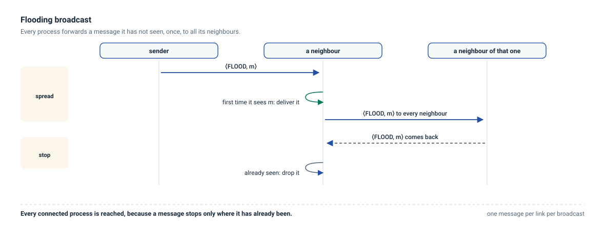
</picture>

Every process that receives a message for the first time delivers it and forwards it to all its neighbors except the one it came from. p1 broadcasts `"hello"` at time 0 and p12 broadcasts `"ok"` 40 ms later.

**What to watch.** The two waves spread across the grid and cross in the middle. Each process delivers each message exactly once; the second handler silently drops copies that arrive by another path. The run uses 46 messages and ends after about 200 ms.

**Try this.**

- Set *Loss* to `0.3` in the *Timing* tab. Flooding has no retransmission, so whether a process still gets a message depends on whether some path survived. With seed 7, ten processes deliver `"hello"` and eight deliver `"ok"`; with seed 2 everybody delivers both.
- Disable two links with the *Enabled* checkbox and see which processes become unreachable.
- Generate a random or tree topology with the same code. The algorithm needs no change.

**Keep in mind.** Messages are identified by their content, so broadcasting the same text twice delivers it only once.

## Ring leader election, Chang-Roberts

**Topic:** leader election · **Model:** asynchronous · **Topology:** directed ring of 8, identifiers in the order 3, 7, 1, 5, 2, 8, 4, 6 · **Seed:** 11

<picture>
  <source media="(prefers-color-scheme: dark)" srcset="assets/diagram-example-chang-roberts-dark.svg">
  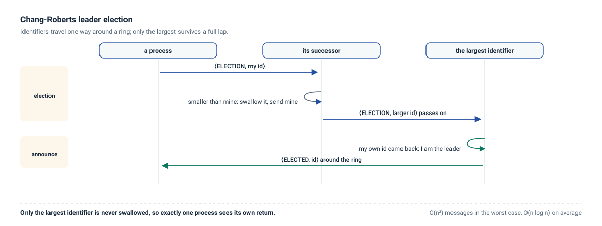
</picture>

Every process starts an election by sending its own identifier clockwise. A process forwards identifiers larger than its own, replaces smaller ones with its own if it has not already done so, and declares itself leader when its own identifier comes back. The winner then circulates an `ELECTED` message.

**What to watch.** Small identifiers disappear quickly; 8 travels the whole ring. Every process outputs `Elected | 8`. The run uses 20 election messages and 8 announcement messages.

**Try this.**

- Change the input to `0ms 1 Start` so that only one process starts. Count the messages.
- Give one link a slow delay distribution, such as `uniform(100ms, 200ms)`, and follow the election around it.
- Rebuild the ring with identifiers in increasing order, using the ring generator with *Directed* checked, and compare the number of messages.

**Keep in mind.** The algorithm assumes reliable FIFO channels and no crashes. A crash breaks the ring and the election never ends.

## FloodSet consensus

**Topic:** consensus with crash failures · **Model:** synchronous rounds · **Topology:** complete graph of 4 · **Seed:** 5

<picture>
  <source media="(prefers-color-scheme: dark)" srcset="assets/diagram-example-floodset-dark.svg">
  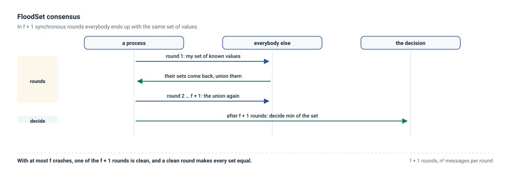
</picture>

Each process proposes a random value from 1 to 9. In each of the first f + 1 rounds (f = 1 here) every process sends the set of values it knows to everybody; at the end of round f + 1 it decides the minimum of its set.

The program also declares three properties, checked after every step: *Agreement* (no two processes decide differently), *Validity* (a decided value is one the process knew) and *Termination* (every correct process decides).

**What to watch.** With the *Ideal synchronous* preset, the proposals are 8, 7, 7 and 3, every process decides 3, and the three properties hold. The dashed vertical lines on the diagram mark the rounds. No violation is possible.

**Try this.**

- Switch to *Realistic synchronous* and run with the same seed. Rounds are now built on drifting clocks, delays have a long tail, and late messages are discarded. The run records 11 violations and 9 discarded messages, and p2 decides 7 while everybody else decides 3: the value 3 never reached p2 in time. *Agreement* is reported as broken at 150 ms on p2, while *Validity* and *Termination* still hold. The algorithm is correct; its assumption is not.
- Change the policy to *Deliver late* and run again. Late messages now reach processes in a later round, and with this seed everybody decides 3 again.
- Try other seeds with the dice button. Disagreement is rare: the minimum has many paths to every process, and all of them must fail. It shows up in roughly 1 seed out of 50.
- Back in *Ideal synchronous*, crash p4 at `0ms`. Its value never spreads, and the others agree on 7.

**Keep in mind.** FloodSet is written for crash-stop: a process that crashes and recovers comes back with an empty set of values, and deciding on it fails with a runtime error. Run a behaviour profile to see it: the *crash and recovery* row reports a failed run, not a broken property. In lockstep rounds a process cannot crash in the middle of its sends, so the classic scenario where a crashing process reaches only some of the others is not reproduced by a crash alone. See [Faults](faults.md#crash).

## Failure detector ◇P

**Topic:** failure detection under partial synchrony · **Model:** partially synchronous, GST at 3 s · **Topology:** complete graph of 4 · **Seed:** 5

<picture>
  <source media="(prefers-color-scheme: dark)" srcset="assets/diagram-example-epfd-dark.svg">
  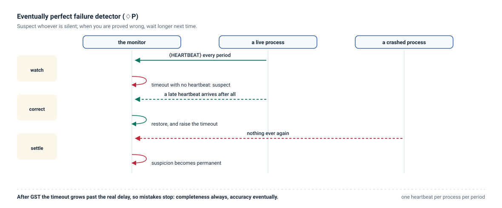
</picture>

Every process periodically asks everybody for a heartbeat. A process that does not answer before the timeout is suspected; if an answer later arrives from a suspected process, the suspicion is withdrawn and the timeout grows by `DELTA0`. Process p3 crashes at 6 s.

**What to watch.**

- Before GST, heavy-tailed delays cause wrong suspicions: 44 `Suspect` and `Restore` outputs in the first three seconds.
- After GST, a few corrections, then silence while the timeouts have grown enough.
- After the crash, p1, p2 and p4 suspect p3 within a second, and nothing else.

Open the *State* tab on any process to follow `suspected` and `delay`.

**Try this.**

- Move GST to `8s`. The crash happens during the unstable period, and it becomes harder to tell apart from slowness.
- Remove GST. Wrong suspicions continue for the whole run.
- Lower `DELTA0` to `20ms` and watch the timeout grow more slowly.

**Keep in mind.** The algorithm uses `DirectLinks`, a perfect link only because the network does not lose messages here. With loss, replace it with `AckLinks` from the library.

## Failure detector across a partition and a recovery

**Topic:** partitions, crash-recovery · **Model:** partially synchronous, GST at 1 s · **Topology:** complete graph of 5 · **Seed:** 5

<picture>
  <source media="(prefers-color-scheme: dark)" srcset="assets/diagram-example-epfd-partition-dark.svg">
  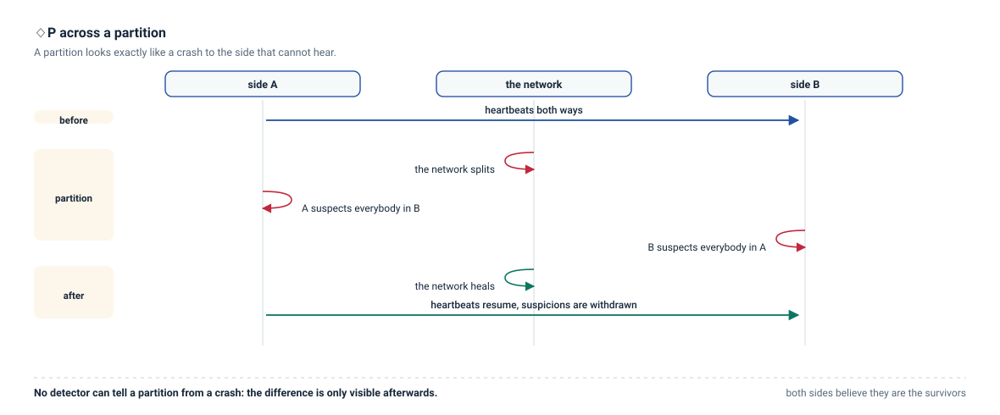
</picture>

The same detector runs on five processes, with three scheduled faults: the network splits into {p1, p2} and {p3, p4, p5} from 4 s to 7 s, p5 crashes at 9 s and recovers at 11 s.

**What to watch.**

- Just before the partition heals, p1 and p2 suspect {p3, p4, p5}, and p3, p4 and p5 suspect {p1, p2}. Each side believes the other crashed.
- After the partition, the suspicions are withdrawn.
- While p5 is down, everybody suspects p5.
- p5 restarts with its state reset and its `Init` handler restarts the heartbeats. By the end of the run nobody suspects anybody.

**Try this.**

- Make the partition permanent by emptying *Until*. Which suspicions never go away?
- Add `stable` in front of `delay` in the code, rerun, and compare p5's timeout after the recovery.
- Pause at 5 s, select p1 and press **Isolate here** to add a second partition from that moment.

**Keep in mind.** Messages in flight when the partition starts are dropped when they arrive. The detector cannot distinguish a partition from a crash, which is exactly the point.

## Reliable broadcast when the sender crashes

**Topic:** reliable broadcast, layering · **Model:** asynchronous, 40% message loss · **Topology:** complete graph of 5 · **Seed:** 4

<picture>
  <source media="(prefers-color-scheme: dark)" srcset="assets/diagram-example-reliable-broadcast-dark.svg">
  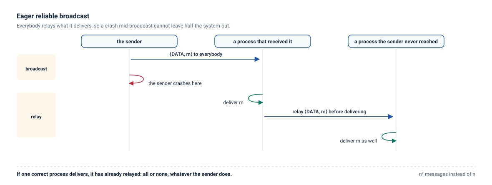
</picture>

A newsroom application publishes through a stack of library modules: *EagerReliableBroadcast* on top of *BasicBroadcast* on top of *AckLinks*. p1 publishes `"news"` at time 0 and crashes at 40 ms, before its first retransmission.

**What to watch.**

- Many of p1's first messages are lost, and p1 is gone before it can resend them.
- p2 received the news and relays it; the relays reach p3, p4 and p5.
- Every process reads the news once.
- Tick **Layers** to color messages by their origin: the application's broadcast, the relays, and the link layer's acknowledgements and retransmissions. Open the *Stack* tab to follow the events through the modules.

**Try this.**

- In the first algorithm, replace `uses ReliableBroadcast` with `uses BestEffortBroadcast` and run with the same seed. Only p2 reads the news.
- Remove the crash. With best-effort broadcast, everybody reads the news again: the difference only shows when the sender fails.
- Replace `ReliableBroadcast` with `UniformReliableBroadcast` and add *MajorityAckURB* from *Add module*.

**Keep in mind.** The crash has to happen before retransmissions, because a step is never interrupted (see [Faults](faults.md#crash)). The loss rate is what makes the partial broadcast possible.

## Causal order broadcast: questions before answers

**Topic:** causal order, vector clocks · **Model:** asynchronous, channels without FIFO, delays from 5 to 120 ms · **Topology:** complete graph of 5 · **Seed:** 5

<picture>
  <source media="(prefers-color-scheme: dark)" srcset="assets/diagram-example-causal-broadcast-dark.svg">
  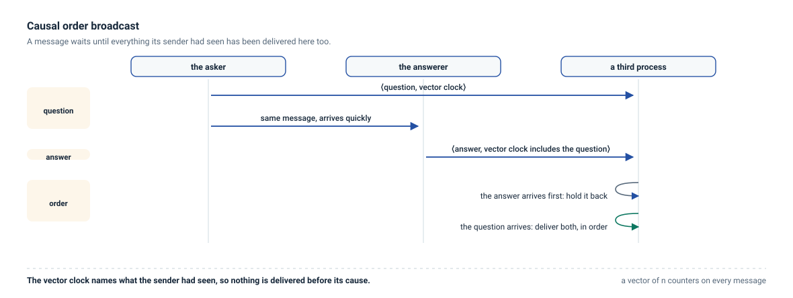
</picture>

p1 posts a question. p2 answers as soon as it reads it. Everything goes through *WaitingCausalBroadcast*, which attaches a vector clock to each message.

**What to watch.** Every process reads the question before the answer, even when the answer arrives first: it waits in the pending set until the question has been delivered.

**Try this.**

- Replace `uses CausalOrderBroadcast` with `uses ReliableBroadcast` and run with the same seed. p4 and p5 read the answer before the question.
- Tick **Causality**, click the event where p2 reads the question, and see which events it could have influenced. The answer is in its future everywhere.
- Open the *State* tab on p4 and watch `pending` hold the answer for a while.

**Keep in mind.** The test suite checks 30 seeds for this example: none delivers an answer before its question.

## Gossip: spreading a rumor

**Topic:** probabilistic broadcast · **Model:** asynchronous · **Topology:** 16 processes on a ring with chords, 4 neighbors each · **Seed:** 7

<picture>
  <source media="(prefers-color-scheme: dark)" srcset="assets/diagram-example-gossip-dark.svg">
  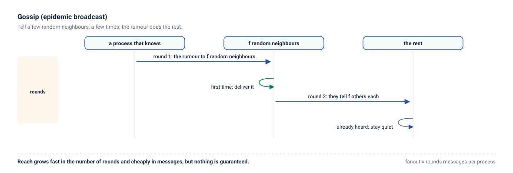
</picture>

p1 spreads a rumor. Each process that hears it for the first time forwards it to `FANOUT` random neighbors, for at most `ROUNDS` hops.

**What to watch.** With `FANOUT := 2` and `ROUNDS := 4`, 10 of the 16 processes hear the rumor, using 16 messages. Nobody hears it twice.

**Try this.** Change the parameters at the top of *EagerGossip*:

| FANOUT | ROUNDS | Processes reached | Messages |
|---|---|---|---|
| 2 | 4 | 10 | 16 |
| 2 | 6 | 14 | 24 |
| 3 | 4 | 16 | 39 |
| 4 | 4 | 16 | 64 |

Try several seeds with the dice button: coverage varies from run to run, which is what *probabilistic* means.

**Keep in mind.** Targets are chosen among neighbors, so the topology shapes the spread. Gossip never retries.

## Perfect failure detector

**Topic:** failure detection with known bounds · **Model:** timed synchronous · **Topology:** complete graph of 4 · **Seed:** 3

<picture>
  <source media="(prefers-color-scheme: dark)" srcset="assets/diagram-example-perfect-detector-dark.svg">
  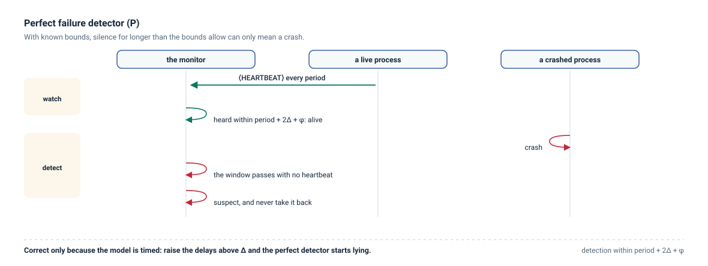
</picture>

Every process sends a heartbeat every 200 ms. A process that hears nothing from a neighbor for longer than `PERIOD + 2·DELTA + PHI` concludes it has crashed, and suspects it forever. p3 crashes at 1 s.

**What to watch.** p1, p2 and p4 suspect p3 within about 220 ms of the crash, and nobody else is ever suspected. The two declared properties say exactly that: *Accuracy* (`always`, no correct process is suspected) and *Completeness* (`eventually`, every crashed process is suspected by every correct one).

**Try this.**

- Raise the delay distribution above `DELTA` in the *Timing* tab. Messages now break the promise the detector relies on, and *Accuracy* is reported broken: the perfect detector is only perfect while the model holds.
- Lower `GRACE` by editing the parameter. Same effect, from the other side.
- Compare with the ◇P example: there, a wrong suspicion is withdrawn and the timeout grows; here, a suspicion is final.

**Keep in mind.** The detector is correct only because the model is timed synchronous. Under partial synchrony the same code is wrong, which is why ◇P exists.

## Eventual leader election Ω

**Topic:** the weakest failure detector for consensus · **Model:** partially synchronous, GST at 3 s · **Topology:** complete graph of 5 · **Seed:** 3

<picture>
  <source media="(prefers-color-scheme: dark)" srcset="assets/diagram-example-omega-leader-dark.svg">
  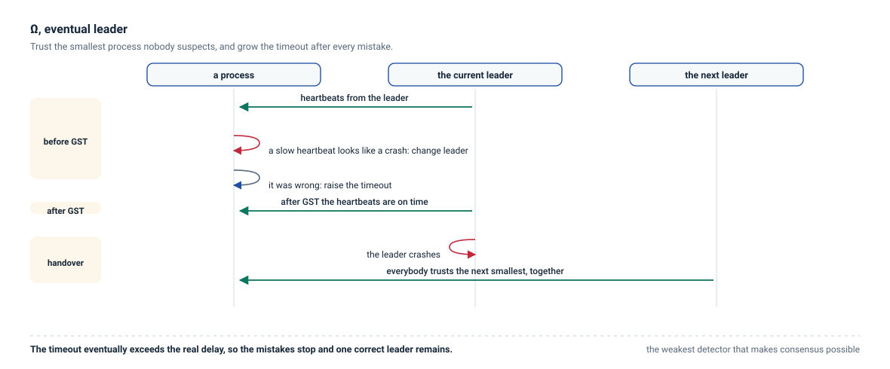
</picture>

Each process suspects the ones it does not hear from, grows its timeout after every mistake, and trusts the smallest process it does not suspect. p1, the natural leader, crashes at 4 s.

**What to watch.** Before GST the trusted leader changes several times, because slow heartbeats look like crashes. After GST the processes settle on p1, and when p1 crashes they move to p2 together. The property *EventualAgreement* asks for the end state: eventually everybody trusts the same process, and that process is correct.

**Try this.**

- Remove the crash: the leader settles and never changes again.
- Move GST to `8s` and watch how much longer the churn lasts.
- Crash p2 as well, a second after p1: the leadership moves again, to p3.

**Keep in mind.** Ω never promises when the churn stops, only that it does. A run that ends during the churn says nothing.

## Mutual exclusion, Ricart-Agrawala

**Topic:** coordination without a coordinator · **Model:** asynchronous · **Topology:** complete graph of 4 · **Seed:** 3

<picture>
  <source media="(prefers-color-scheme: dark)" srcset="assets/diagram-example-mutual-exclusion-dark.svg">
  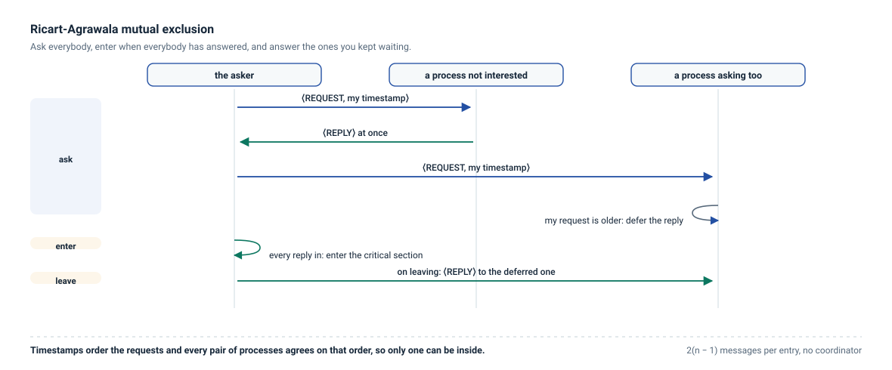
</picture>

A process that wants the critical section stamps its request with a logical clock and asks everybody. A process that receives a request answers at once if it is not interested or if the request is older than its own, and defers the answer otherwise. Whoever collects every answer enters, holds the section for 300 ms, then answers the requests it deferred. p1, p2 and p3 ask within 7 ms of each other.

**What to watch.** The three enter one at a time, in timestamp order, and the property *MutualExclusion* (`always`, at most one process inside) holds throughout. The deferred answers are visible on the diagram as the messages that leave right after each *Exit*.

**Try this.**

- Add `0ms * Acquire` to make everybody ask at the same instant: the tie is broken by process number, which is what the `ts = myTs and from < self` condition is for.
- Crash a process while it holds the critical section: nobody enters again, and the algorithm gives no way out. That is the price of an algorithm written for a failure-free model.
- Turn off FIFO channels: the algorithm still holds, because it depends on timestamps, not on order.

## Two-phase commit and the blocked participants

**Topic:** atomic commit and its famous weakness · **Model:** asynchronous · **Topology:** complete graph of 4 · **Seed:** 3

<picture>
  <source media="(prefers-color-scheme: dark)" srcset="assets/diagram-example-two-phase-commit-dark.svg">
  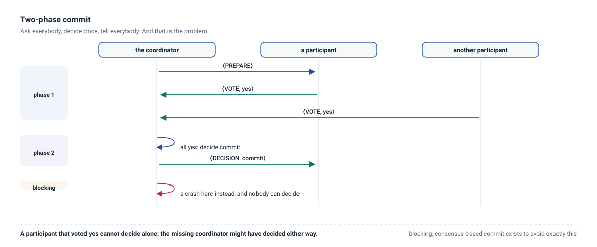
</picture>

p1 is the coordinator: it asks everybody to prepare, collects the votes, decides and announces the outcome. Everybody votes yes here.

**What to watch.** All four processes report `COMMIT`, and both properties hold: *Agreement* (`always`, nobody decides differently) and *Termination* (`eventually`, every correct process decides).

**Try this.**

- Crash the coordinator at `25ms`, after the votes arrive and before the announcement. Nobody decides: *Agreement* still holds, *Termination* is reported broken. The participants know their own vote and nothing else, and no timeout can help them, because a missing coordinator could have decided either way. This is the blocking problem that three-phase commit and consensus-based commit exist to solve.
- Crash it at `60ms` instead, after the announcement has left: the others decide normally.
- Make one participant vote `NO` by editing the `PREPARE` handler, and watch the outcome change to `ABORT`.

## Logical clocks: Lamport and vector

**Topic:** what a clock without time can tell you · **Model:** asynchronous · **Topology:** complete graph of 4 · **Seed:** 3

<picture>
  <source media="(prefers-color-scheme: dark)" srcset="assets/diagram-example-logical-clocks-dark.svg">
  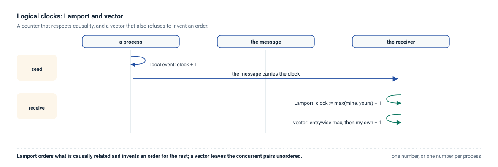
</picture>

Every message carries both clocks. On receipt the Lamport counter jumps past the timestamp it received and adds one; the vector takes the entrywise maximum and then counts the local event.

**What to watch.** The *State* tab shows both clocks of the selected process. Follow a chain of messages on the diagram and read the Lamport numbers along it: they only ever grow. Now find two events on different processes with no path between them: their Lamport numbers say nothing, while their vectors are incomparable, and that is exactly the difference between the two clocks.

The declared property *OwnEntryIsHighest* says what a vector clock guarantees: nobody knows more about me than I do, so my own entry is never behind the one somebody else keeps for me. *EverybodyTicks* checks that every process takes part.

**Try this.**

- Add `0ms * Tick | 1` to make everybody send at once, and compare the vectors afterwards.
- Turn off FIFO channels: the clocks still hold, because they do not depend on order.
- Delete the `max` in the Lamport handler and watch *assert* fail: the counter no longer passes the timestamp it received.

**Keep in mind.** A Lamport clock orders what is causally related and invents an order for the rest; a vector clock refuses to order what is concurrent. Neither measures time.

## Chandy-Lamport snapshot on FIFO channels

**Topic:** recording a global state without stopping the system · **Model:** asynchronous, FIFO channels · **Topology:** complete graph of 4 · **Seed:** 3

<picture>
  <source media="(prefers-color-scheme: dark)" srcset="assets/diagram-example-snapshot-dark.svg">
  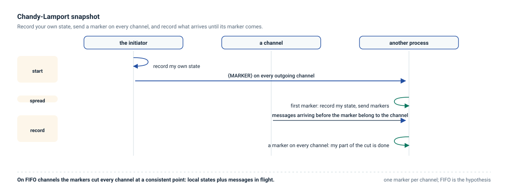
</picture>

Four processes start with 100 coins each and move them around. At 6 ms p1 is asked for a snapshot: it records its own balance, sends a marker on every channel, and records what arrives on a channel until that channel's marker comes. Everybody else does the same on the first marker it receives.

**What to watch.** The four processes report 95, 110, 110 and 85: not the balances at any single instant, since there is no such instant, but a consistent cut whose total is 400, the number of coins in the system. The property *Conservation* checks exactly that, and *SnapshotOnce* that nobody finishes without having recorded its own state.

**Try this.**

- **Turn off FIFO channels** in the *Timing* tab and run seeds 11 and 13. The recorded total becomes 370: coins vanish, because a marker can overtake a coin that should have been counted in flight. FIFO is not a detail of the algorithm, it is its hypothesis.
- Move the `Snap` request later, after every transfer has arrived: the cut becomes the obvious one, with no messages in flight.
- Ask two processes to snapshot at the same moment: the markers meet, and the cut is still consistent.

## Majority-quorum register

**Topic:** replication that survives a minority · **Model:** asynchronous · **Topology:** complete graph of 5 · **Seed:** 3

<picture>
  <source media="(prefers-color-scheme: dark)" srcset="assets/diagram-example-quorum-register-dark.svg">
  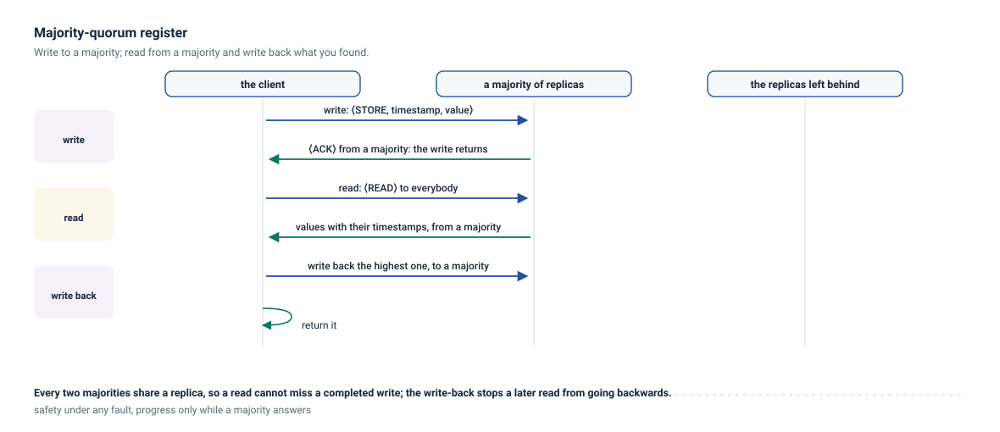
</picture>

Every process keeps a copy of one register. Writing stamps the value and waits for a majority to store it. Reading asks everybody, takes the value with the highest stamp, and **writes it back** to a majority before returning: without that second phase, a later reader could still see an older value. p1 writes 42, then p3 and p5 read.

**What to watch.** Both readers return 42, and the two declared properties hold: *ReadsAreValid* (`always`, a read never returns something other than what the writer holds) and *OperationsReturn* (`eventually`, the operations finish).

**Try this.** These four runs are the whole theory of quorums, and the [behaviour profile](interface.md#batch-runs) shows them in four rows:

| Condition | What happens |
|---|---|
| no faults | everybody returns |
| **a minority crashes** (p2 and p4) | everybody still returns: a majority is alive, and every majority meets every other |
| **a majority crashes** (p2, p4 and p5) | nothing returns. *ReadsAreValid* still holds, *OperationsReturn* is broken: safety never depends on how many are alive, liveness always does |
| **a partition 3 \| 2** | the side with p1, p2 and p3 keeps working; p5, alone with p4, waits forever |

Run the profile over ten seeds and the point becomes a rule: *ReadsAreValid* holds under **every** condition, while *OperationsReturn* falls under crashes, partitions and a zone going down. A quorum system does not trade safety for availability; it gives up availability to keep safety.

**Keep in mind.** The replica state is `stable`, so a process that comes back still has its data, as a replicated store on disk would. This is a single-writer register, so timestamps never collide. With several writers the stamps have to carry the identity of the writer as well, and the read-back phase becomes essential rather than merely useful.

## Total order broadcast with a sequencer

**Topic:** agreeing on an order, cheaply · **Model:** asynchronous · **Topology:** complete graph of 4 · **Seed:** 3

<picture>
  <source media="(prefers-color-scheme: dark)" srcset="assets/diagram-example-total-order-dark.svg">
  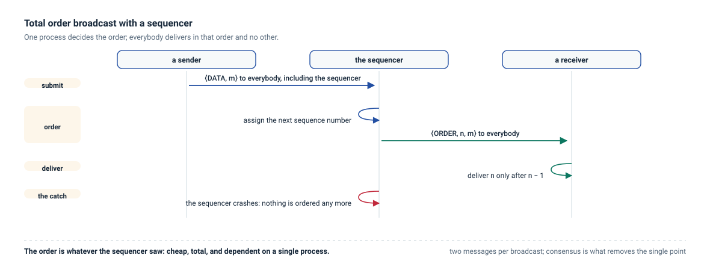
</picture>

Everybody sends its message to all; p1, the sequencer, is the only process that decides the order and announces it. A process delivers a message only once every earlier sequence number has arrived.

**What to watch.** The three messages are broadcast in the order a, b, c and delivered by everybody as **b, c, a**: the order is the one the sequencer saw, not the one the senders intended, and that is the point. The property *TotalOrder* (`always`) says what the algorithm promises: what one process has delivered is a prefix of what any other has delivered, so nobody ever sees two messages in a different order.

**Try this.**

- **Crash the sequencer** at `3ms`: deliveries stop altogether. *TotalOrder* still holds — nobody has seen anything wrong — while *EverybodyDelivers* is broken. One process deciding the order is cheap and fragile at the same time; making it fault-tolerant is what consensus is for.
- **Deliver without waiting for the order**, by replacing the `skip` in the second `DATA` handler with an immediate delivery: *TotalOrder* breaks at once, which is what a property is for.
- Turn off FIFO channels: the algorithm still holds, because the sequence numbers, not the channels, carry the order.

## Paxos: consensus on one value

**Topic:** the algorithm the previous example was missing · **Model:** asynchronous · **Topology:** complete graph of 5 · **Seed:** 3

<picture>
  <source media="(prefers-color-scheme: dark)" srcset="assets/diagram-example-paxos-dark.svg">
  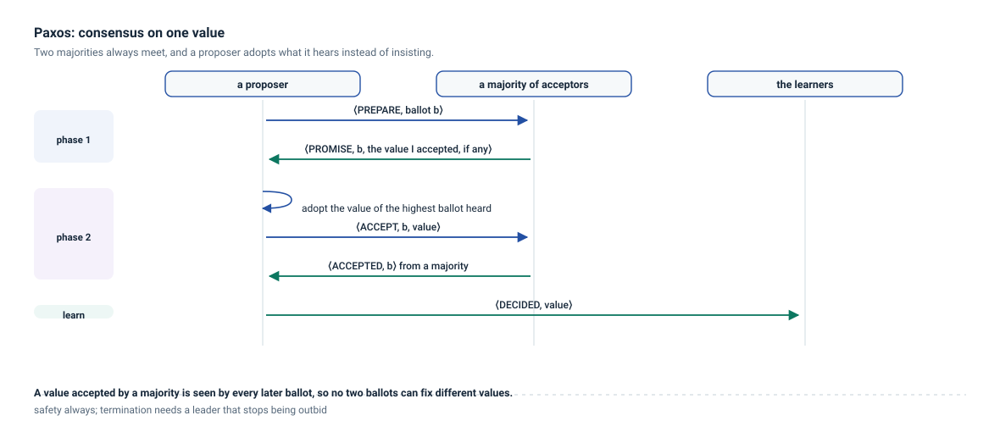
</picture>

The [total order example](#total-order-broadcast-with-a-sequencer) ends with the sequencer crashing and everything stopping. Paxos is the answer to that sentence: nobody is indispensable.

Every process is acceptor and learner; p1 proposes "A" and p2 proposes "B" five milliseconds later. A proposer picks a ballot number nobody else can use, asks a majority to promise not to accept anything older, **adopts the most recent value it hears about** instead of its own, and then asks that majority to accept it. Two majorities always meet, and that is the whole argument.

**What to watch.** Everybody decides "B", including p1, which proposed "A": the second ballot was higher, and the first proposal had not been accepted by a majority yet. The properties are *Agreement* (`always`, nobody decides differently), *Validity* (`always`, a decided value is one somebody proposed) and *Termination* (`eventually`, every correct process decides).

**The profile is the lesson.** Over ten seeds and ten fault conditions, *Agreement* and *Validity* hold **everywhere**, while *Termination* falls under crashes, partitions and a zone going down:

| Condition | Result |
|---|---|
| no faults, pauses, link failures, omissions | everything holds |
| one crash, two crashes, a partition, a zone | agreement and validity hold, termination breaks in some seeds |
| **a majority crashes** | nobody decides, and nobody decides wrongly |

Safety costs nothing; liveness costs a majority. This is the shape of every quorum-based algorithm, and it is the same shape as the [register](#majority-quorum-register).

**Try this.**

- Crash p1 at `8ms`, in the middle of its ballot: the others decide anyway.
- Make both proposals start at `0ms`: the ballots interleave, one proposer restarts, and the decision takes longer. With unlucky timing they could keep interrupting each other forever, which is exactly what FLP says and what Ω exists to avoid.
- Add `link:0.5/s` faults: the decision survives, because a majority is still reachable.

**Keep in mind.** This is one value, one round, no reconfiguration and no leader: a proposer that keeps being outbid never gives up. Real systems add a leader (Ω), a log of values and a way to change the membership.

## Ben-Or: consensus with a coin

**Topic:** buying termination with randomness · **Model:** asynchronous · **Topology:** complete graph of 5 · **Seed:** 3

<picture>
  <source media="(prefers-color-scheme: dark)" srcset="assets/diagram-example-ben-or-dark.svg">
  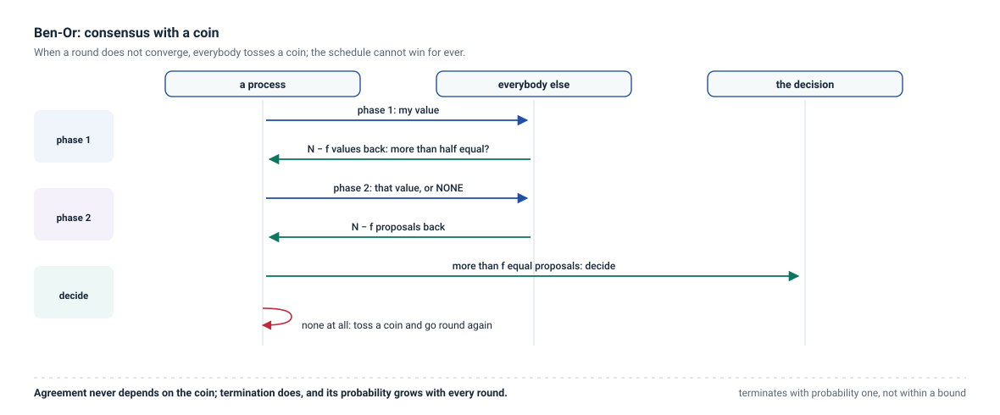
</picture>

[Paxos](#paxos-consensus-on-one-value) keeps agreement whatever happens but cannot promise to finish: that is FLP. Ben-Or finishes, with probability one, by giving up determinism.

Three processes propose 1 and two propose 0. Each round has two phases: everybody reports its value and waits for `N - F` reports, and a value held by more than half becomes that process's proposal; then everybody reports that proposal and waits for `N - F` of them. More than `F` equal proposals decide; a single one is adopted; none at all, and the process **tosses a coin**. A process that has decided runs one more round to carry its value to the others, then stops.

**What to watch.** With seed 3 everybody decides 0, although 0 was the minority proposal: nothing in the algorithm favours the majority, and the coin can carry either value. Change the seed and the decision changes with it — over twenty seeds the outcome is 0 in about half of them — while *Agreement* and *Validity* hold in every one.

**Try this.**

- **Run a batch over `1..20`**: every seed terminates, the median run costs about 255 messages and the last process decides around 240 ms, but the spread is wide. That spread *is* the algorithm: it terminates with probability one, not within a bound.
- Make everybody propose the same value: the first round decides, with no coin at all.
- Crash one process at `20ms`: with `F = 2` the remaining four still make progress.
- Crash three: nothing decides, and nothing decides wrongly.

**Keep in mind.** The coin is local, not shared: each process tosses its own. That is enough because a schedule that keeps the processes apart has to win every toss, and its chances halve at every round. With a shared coin the expected number of rounds would be constant rather than exponential in the worst case.

## Empty scenario

A ring of five processes and a small program that greets its neighbors and counts replies. Use it as a starting point for your own algorithms, and see [Getting started](getting-started.md) for a guided first program.
